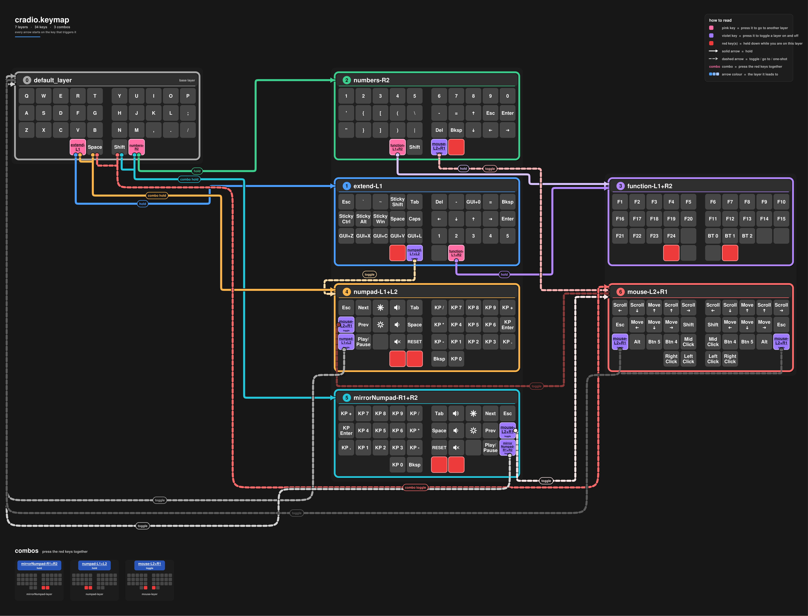

# zmk-config-test

previously edited with https://nickcoutsos.github.io/keymap-editor/ but it depreciated 
  
edit directly from keymap file, with flowchart below (click below)  
[View PDF](current-keymap.pdf)
 

## known limitations and assumptions for generate.py
- parser depends on newlines for next row -> keymap use standard layout (ie 5 keys left, 5 keys right, \n...)
- assumes that there are layer keys -> if none, will not display
